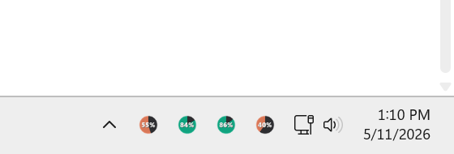
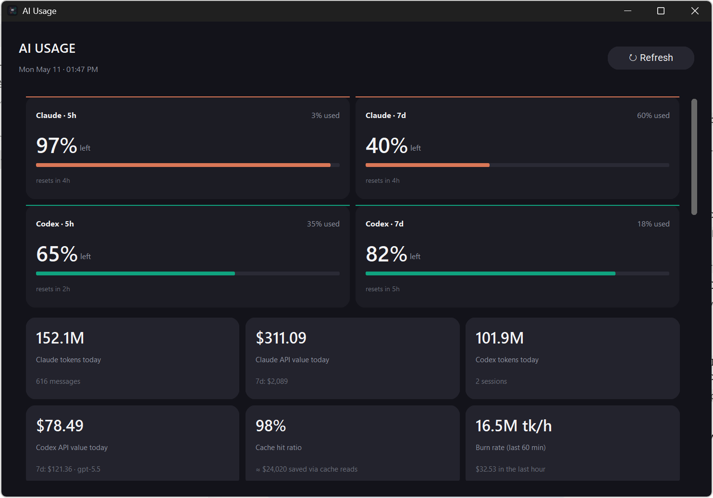
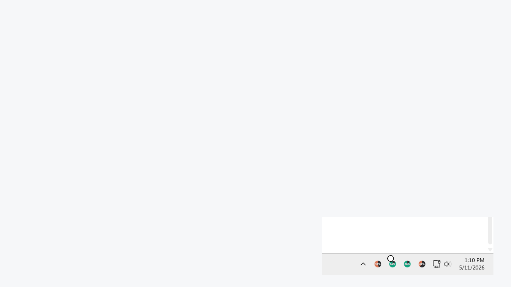

# AI Usage Tray

<p align="center">
  
</p>

Windows tray icons for local Claude Code and Codex CLI usage.

The app runs four notification-area icons:

- Claude 5-hour window
- Claude weekly window
- Codex 5-hour window
- Codex weekly window

Each icon shows percentage left. Clicking any icon opens the native stats dashboard with today's totals, Claude and Codex API-value estimates, model split, top projects/tools, activity heatmap, and recent daily totals.







## Install

Use Python 3.11+ on Windows.

```powershell
git clone https://github.com/LLRHook/usage-widget.git
cd usage-widget
py -3 -m venv .venv
.\.venv\Scripts\python.exe -m pip install -r requirements.txt
.\.venv\Scripts\python.exe .\tray.py --install-startup
```

The installer writes a current-user `Run` registry entry named `AI Usage Tray` and launches the tray immediately. It also removes legacy Startup-folder shortcuts from older builds.

## Run Manually

```powershell
.\.venv\Scripts\pythonw.exe .\tray.py
```

Right-click any tray icon for `Refresh now`, `Open dashboard`, or `Quit`.

## Uninstall

```powershell
.\.venv\Scripts\python.exe .\tray.py --uninstall-startup
```

To remove the old Windows widget package from previous builds, run:

```powershell
Get-AppxPackage -Name AIUsageWidget | Remove-AppxPackage
```

## Data Sources

- Claude data is read from `%USERPROFILE%\.claude\projects`.
- Codex data is read from `%USERPROFILE%\.codex\sessions`.
- Claude plan percentages come from `probe_claude.py`, which uses Claude Code's local OAuth credentials and caches rate-limit headers in `%TEMP%\claude_ratelimits.json`.
- Codex percentages and API-value estimates come from local Codex `token_count` payloads. Cost estimates use OpenAI list prices for the detected model and treat cached input at the cached-input rate when available.

No telemetry is sent by this app except the optional Claude rate-limit probe to Anthropic when `probe_claude.py` refreshes its cache. Cost figures are local estimates for comparison, not billing statements.

The Claude probe keeps the last available measurements during network or credential failures and waits at least five minutes before retrying. It also honors a longer `Retry-After` from the server, including when a forced refresh is requested. A rate-limited response can still update the displayed utilization when it includes usage headers. Cache writes are atomic so the tray and dashboard can read them concurrently.

For a cache-only check that never reads credentials or sends a request:

```powershell
.\.venv\Scripts\python.exe .\probe_claude.py --no-network
```

## Tests

Run the regression suite with Python 3.11+:

```powershell
python -m unittest discover -v
python -m py_compile widget.py widget_native.py tray.py probe_claude.py
```

The tests use temporary JSONL/cache fixtures and mock HTTP, subprocess, and GUI backends. They do not read local usage records or credentials, open desktop windows, or make network requests. No additional test dependencies are required.
