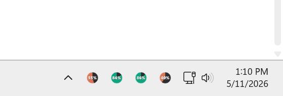
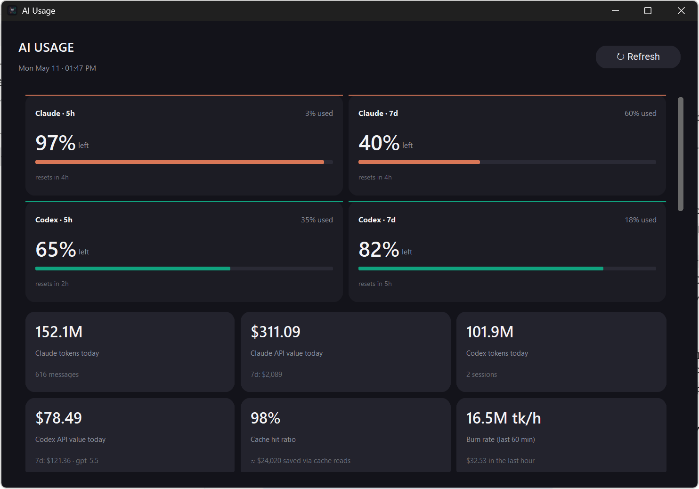
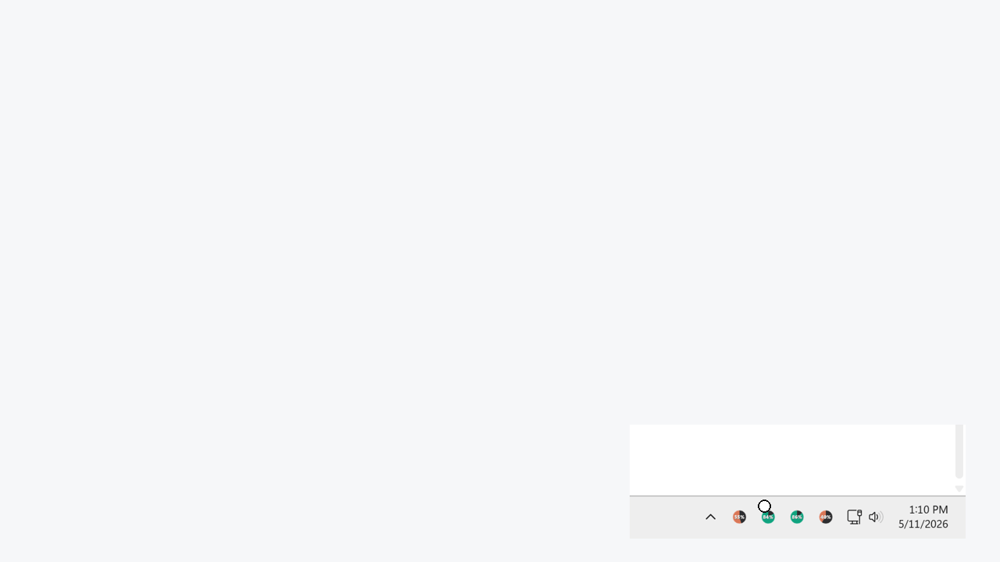

# AI Usage Tray

<p align="center">
  
</p>

Windows tray icons for local Claude Code and Codex CLI usage.

The app runs four notification-area icons:

- Claude 5-hour window
- Claude weekly window
- Codex 5-hour window
- Codex weekly window

Each icon shows percentage left. Clicking any icon opens the native stats dashboard with today's totals, Claude and Codex API-value estimates, model split, top projects/tools, activity heatmap, and recent daily totals.







## Install

Use Python 3.11+ on Windows, plus Rust 1.85+ and a native linker to build the
collector. Follow the [Rust installation instructions](https://doc.rust-lang.org/book/ch01-01-installation.html)
for the Windows MSVC prerequisites. Rust and Python must use the same CPU
architecture. Build the collector before launching or installing startup.

```powershell
git clone https://github.com/LLRHook/usage-widget.git
cd usage-widget
py -3 -m venv .venv
.\.venv\Scripts\python.exe -m pip install -r requirements.txt
.\.venv\Scripts\python.exe .\build_native.py
.\.venv\Scripts\python.exe .\tray.py --install-startup
```

The installer writes a current-user `Run` registry entry named `AI Usage Tray` and launches the tray immediately. It also removes legacy Startup-folder shortcuts from older builds.

## Run Manually

```powershell
.\.venv\Scripts\pythonw.exe .\tray.py
```

Right-click any tray icon for `Refresh now`, `Open dashboard`, or `Quit`.

## Uninstall

```powershell
.\.venv\Scripts\python.exe .\tray.py --uninstall-startup
```

To remove the old Windows widget package from previous builds, run:

```powershell
Get-AppxPackage -Name AIUsageWidget | Remove-AppxPackage
```

## Data Sources

- Claude data is read from `%USERPROFILE%\.claude\projects`.
- Codex data is read from `%USERPROFILE%\.codex\sessions`.
- Claude plan percentages come from `probe_claude.py`, which uses Claude Code's local OAuth credentials and caches rate-limit headers in `%TEMP%\claude_ratelimits.json`.
- Codex percentages and API-value estimates come from local Codex `token_count` payloads. Cost estimates use OpenAI list prices for the detected model and treat cached input at the cached-input rate when available.

No telemetry is sent by this app except the optional Claude rate-limit probe to Anthropic when `probe_claude.py` refreshes its cache. Cost figures are local estimates for comparison, not billing statements.

The Claude probe keeps the last available measurements during network or credential failures and waits at least five minutes before retrying. It also honors a longer `Retry-After` from the server, including when a forced refresh is requested. A rate-limited response can still update the displayed utilization when it includes usage headers. Cache writes are atomic so the tray and dashboard can read them concurrently. A shared file lock coordinates updates across processes, so an older failed request cannot replace a newer measurement or impose a stale cooldown on it.

For a cache-only check that never reads credentials or sends a request:

```powershell
.\.venv\Scripts\python.exe .\probe_claude.py --no-network
```

## Native Collector

The normal tray and dashboard refresh commands still call `widget.py --json`.
The collector reads Claude JSONL files once per refresh and passes one normalized
batch to the required Rust library through Python's standard-library `ctypes`.
Rust computes message deduplication, token and cost totals by day/model/project,
the activity heatmap, tool rankings, burn rate, and the two sliding-window counts.
There is no per-record subprocess or Python aggregation fallback.

Python retains JSONL recovery and coercion, pricing tables, local-time and DST
interpretation, the Codex collector and rate-limit merge rules, probe/cache I/O,
and all desktop UI and startup orchestration. Token counters remain signed,
arbitrary-precision integers. Cost estimates retain the existing binary64 formula
and evaluation order. All-time dedup claims a message ID before validating its
timestamp; each sliding window deduplicates eligible messages independently.

`python build_native.py` uses the locked Cargo dependencies and stages only the
host library under `native/lib/<platform>-<architecture>-<bits>/`. It respects
`CARGO_TARGET_DIR`. Build separately for each OS and Python architecture; copying
a library from another target is unsupported. The loader uses an absolute
app-relative path and checks the ABI version. A missing library, incompatible
architecture, or ABI mismatch causes a collector error with rebuild instructions. The tray retains its
last snapshot on refresh failure, and the dashboard reports its query error.
The collector never compiles or downloads dependencies during refresh. The batch
uses memory proportional to the normalized Claude history; no speed or memory
improvement is claimed without measurement.

For an isolated collector run, provide all three explicit paths:

```powershell
python widget.py --json --claude-projects ./fixtures/claude --codex-sessions ./fixtures/codex --claude-cache ./fixtures/claude-cache.json
```

These overrides do not change the default data sources or activate the probe.
The cache is read-only and can be absent. The portable collector can also be built
and tested on macOS and Linux; the tray and startup installer remain Windows
features.

## Tests

Build the native library, then run the regression suite with Python 3.11+:

```powershell
cargo fmt --manifest-path native/Cargo.toml -- --check
cargo test --locked --manifest-path native/Cargo.toml
cargo clippy --locked --manifest-path native/Cargo.toml --all-targets -- -D warnings
python build_native.py
python -m unittest discover -v
python -m py_compile widget.py widget_native.py tray.py probe_claude.py usage_core.py build_native.py
```

The tests use explicit temporary JSONL/cache roots and mock HTTP and GUI backends.
Native integration tests load the actual staged library, compare results against
an independent retained Python collector, and run the real `widget.py` subprocess
behind the dashboard/tray adapters. They cover malformed input, missing libraries,
architecture lookup, large/signed counters, floating-point costs, timestamp and
window boundaries, deduplication, and stable ranking ties. They do not read local
usage records or credentials, open desktop windows, change startup settings, or
make network requests. No additional Python test dependencies are required.

GitHub Actions is configured to run these commands on Python 3.11 and 3.13 on
Linux, macOS, and Windows for pull requests and branch pushes. It uses a read-only
repository token and does not install desktop dependencies or require account
credentials. Headless collector tests do not establish Windows tray rendering,
interactive dashboard behavior, or startup acceptance; those need separate manual
Windows validation.
